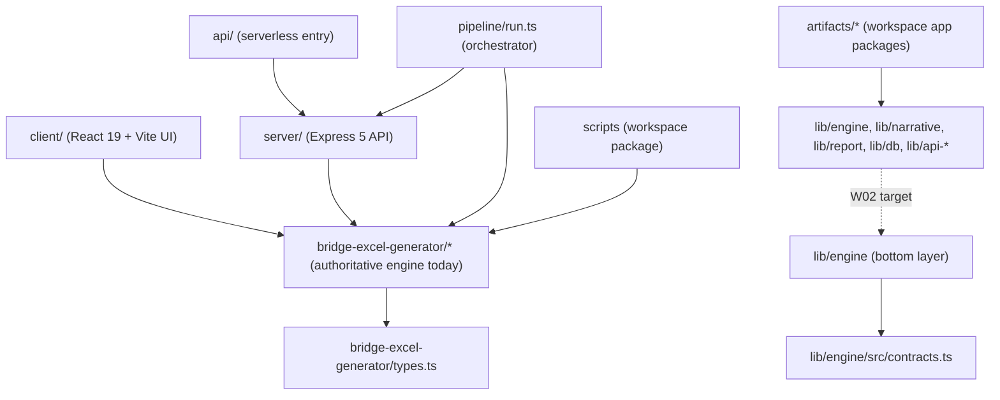

<!-- docs/phase-2/ARCHITECTURE.md (filled from _templates/ARCHITECTURE.md, W01 T1.1) -->
# ARCHITECTURE

Scope: the tree as it is on the foundation commit, not the tree Phase 2 intends.
Where the two differ, the difference is named in "Two engines" below and is the
W02 deliverable.

## Module graph

Declared pnpm workspaces (`pnpm-workspace.yaml`): `artifacts/*`, `lib/*`,
`lib/integrations/*`, `scripts`. `client/`, `server/`, `api/` and
`bridge-excel-generator/` are **not** workspaces; they belong to the root package.
That is a fact about the current tree, not a design.

## Dependency rules

| From | May import | Must NOT import |
| --- | --- | --- |
| `lib/engine/**` (bottom layer) | Node builtins; `lib/engine/src/*` | `server/**`, `client/**`, `bridge-excel-generator/**` |
| `bridge-excel-generator/**` | its own modules, `lib/engine/src/contracts.ts` | `client/**` |
| `client/**` | `bridge-excel-generator/*` (via the reviewed allowlist) | `server/**` internals |
| `server/**` | `bridge-excel-generator/*`, `lib/**` | `client/**` |
| `pipeline/run.ts` | `bridge-excel-generator/*`, `server/*` | — (it is the top orchestrator) |
| `scripts/**` | anything (tooling) | — |

The engine is the bottom of the tree: nothing in it may reach upward into a
consumer. `containment/CONTRACT.md` is the prose authority for this table.

## Forbidden-import enforcement

Two mechanisms exist; only one of them is active today.

1. **`eslint.config.js` — `no-restricted-imports` on `lib/engine/**/*.ts`**,
   pattern group `["server/**", "client/**", "bridge-excel-generator/**"]`,
   with message "lib/engine is the bottom layer: see containment/CONTRACT.md".
   It also sets `@typescript-eslint/no-explicit-any = "error"` for all
   `**/*.ts` / `**/*.tsx`. **STATUS: inert.** The ESLint packages are declared in
   `.deps-plan.json` under owning week W00 and are not installed, so nothing runs
   this config yet. There is no `eslint-baseline.json`, because a baseline that
   was not measured would be a fabrication.

2. **`scripts/foundation/import-guard.mjs`** (`pnpm run verify:imports`, wired
   into `gate:foundation` and `pnpm run gate`). This is the mechanism that
   actually runs. It enforces two rules:
   - **Deep-import allowlist.** `foundation/imports.allow.json` holds the
     reviewed baseline of files permitted to import an engine module directly. A
     new deep importer fails until it is reviewed and the baseline is re-seeded
     with `node scripts/foundation/import-guard.mjs --write`.
   - **Mirror identity.** For each `manifest.mirrors` root, the mirror file must
     be byte-identical to its `client/src/report-engine/**` source, or absent
     (reported `ABSENT`, which is honest, not a silently-passing pair).
   Scan roots: `client/src`, `scripts`, `tests`, `server`,
   `bridge-excel-generator`, `api`, `foundation`, skipping
   `node_modules`/`dist`/`build`/`.out`. Engine modules are read from
   `foundation/manifest.json` `engineModules` (8 entries).

## The one pipeline

`pipeline/run.ts` owns the whole chain and reports each stage's status, wall
time and output size. Arrows and the single file that owns each:

| Arrow | Owning file | Command |
| --- | --- | --- |
| input → validate | `bridge-excel-generator/input-contract.ts` (`ProjectInputSchema.safeParse`) | — |
| validate → calculate | `bridge-excel-generator/design-engine.ts` (`calculateCompleteDesign`) | — |
| calculate → workbook | `bridge-excel-generator/index.ts` (`generateCompleteExcel`) | — |
| calculate → PDF (short) | `server/pdf-export.ts` (`generateDesignPDF`) | — |
| calculate → PDF (comprehensive) | `server/comprehensive-pdf-export.ts` (`generateComprehensivePDF`) | — |
| calculate → PDF (landscape book) | `server/landscape-pdf-export.ts` (`generateLandscapeBookPDF`) | — |
| calculate → HTML report | `server/design-report.ts` (`generateHTMLDesignReport`) | — |
| calculate → checklist | `server/checklist-export.ts` (`generateIrcChecklistHTML`) | — |
| all of the above | `pipeline/run.ts` (orchestrator) | `pnpm run pipeline` |

Template inputs come from `server/default-project-inputs.ts`
(`PHASE1_QUICK_TEMPLATES`); an ad-hoc run takes `--input=<json>`, which is
validated through the same `ProjectInputSchema`. Output defaults to
`tmp/pipeline/` (git-ignored), never `out/`, because `out/` holds tracked reports.

The narrative stage is reported **SKIPPED**, not faked: `lib/narrative` consumes
`@workspace/engine`'s `BridgeCalculationResult`, a different domain model from
this pipeline's `CompleteDesignResult`. Joining them is the open engine-decoupling
item.

## Two engines

`foundation/manifest.json` names
`bridge-excel-generator/design-engine.ts` as the **authoritativeEngine**, with 8
`engineModules` (design-engine, types, and six `client/src/report-engine/lib/*`
calculators) and one mirror root (`client/src/report-engine-weaver`). Separately,
`lib/engine/` holds the **W02 target** surface — `contracts.ts`, `calculate.ts`,
`coefficients.ts`, `fingerprint.ts`, `traceability.ts`, `narrative.ts`,
`html-report.ts`, `diagrams.ts` and `functions/{loads,resistance,serviceability}.ts`
— whose types (`CheckResult`, `FormulaTrace`, `RunFingerprint`, `DesignResult`)
are the Phase-2 contract. The two coexist; `lib/engine` is the shim that migrates
in W02. Any statement that there is one engine today is false.

## Retired paths

Rows from `archive/MANIFEST.md` (the register is the authority; this table is a
reading of it).

| Path | Replaced by | Archived at | Manifest row |
| --- | --- | --- | --- |
| `api/index.ts` | `server/` | `archive/api/index.ts` | yes (pre-W00, verified: no) |
| `client/src/**` (pre-Vite-split) | `client/src/**` (current) | `archive/client/src/**` | yes (pre-W00, verified: no) |
| `origin-weekly-plan.md` | `creat.md` | `archive/20261023-w00-closeout/origin-weekly-plan.md` | yes (W00, sha256 `9eed496e…`) |
| `docs/plan-b/15-week-implementation-plan.md` | `creat.md` | `archive/20261023-w00-closeout/15-week-implementation-plan.md` | yes (W00, sha256 `2ec9f5d6…`) |
| `docs/week1/**` | `docs/week-1/**` | `archive/20261023-w00-closeout/docs-week1/**` | yes (W00, dir) |
| `docs/week3/**` | `docs/week-3/**` | `archive/20261023-w00-closeout/docs-week3/**` | yes (W00, dir) |
| `bridge-excel-generator/sheets-extracted/` | engine-backed sheet views | `archive/sheets-extracted/` | **no register row** — present on disk only; row is owed |

The last row is an honest gap, not a claim: `archive/sheets-extracted/` exists on
disk but has no `archive/MANIFEST.md` row, so the register and the tree disagree.
Reconciling it is a W00 follow-up.

Pending retirements (declared, not yet moved) are listed in
`archive/MANIFEST.md` §"Pending retirements (not yet moved)"; nothing is deleted —
archive-never-delete is the ground rule.
