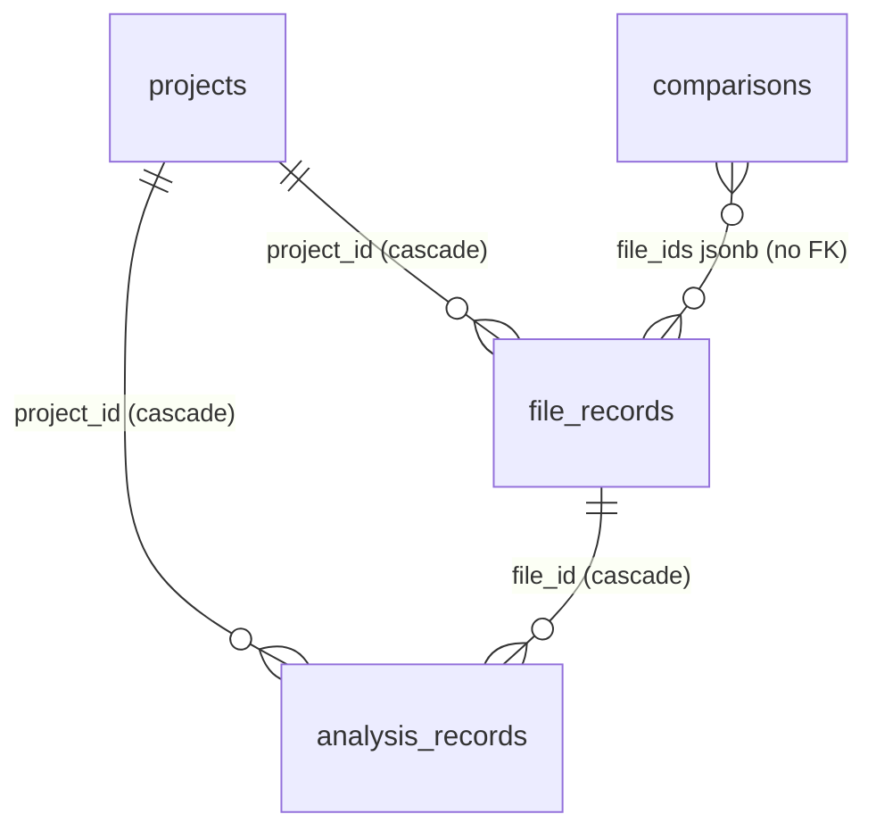

<!-- docs/phase-2/DATA-MODEL.md (filled from _templates/DATA-MODEL.md, W01 T1.5) -->
# DATA MODEL

## Which schema is real

There are **two** database entry points, and only one of them has a schema.

| Entry point | File | Schema | Used by |
| --- | --- | --- | --- |
| **Live** | `shared/db.ts` (`db`, `requireDb`) + `shared/schema.ts` | 4 pgTable definitions | `server/d4-routes.ts` |
| Placeholder | `lib/db/src/index.ts` | `const schema = {};` — **empty**, comment reads "Placeholder schema – no external file" | nothing in the request path |

`lib/db/src/index.ts` also constructs a `pg.Pool` and **throws at import time** when
`DATABASE_URL` is unset, so anything importing it is unusable without a database.
`shared/schema.ts` is the schema the API actually queries. Any ER diagram that
describes `lib/db` as the model is describing a placeholder.

## ER diagram

`comparisons.file_ids` is a `jsonb` array of ids with **no** foreign key — the
many-to-many to `file_records` is referential only by convention, not by the
database.

## Tables (`shared/schema.ts`)

### `projects`

| Column | Type | Constraints |
| --- | --- | --- |
| `id` | serial | primary key |
| `name` | text | not null; insert schema requires min length 1 |
| `location` | text | — |
| `district` | text | — |
| `engineer` | text | — |
| `design_data` | jsonb | typed by `designDataSchema` (see below) |
| `created_at` | timestamptz | default `now()` |
| `updated_at` | timestamptz | default `now()` |

`design_data` is **not** `z.any()`. It is a `designDataSchema` of optional,
nullable `description`, `bridgeType`, `status`, `location`, `district`,
`engineer`, with `.passthrough()` — the CURSOR-003 fix, so consumer-specific keys
(design snapshots, tags) survive without being re-declared.

### `file_records`

| Column | Type | Constraints |
| --- | --- | --- |
| `id` | serial | primary key |
| `project_id` | integer | → `projects.id`, `ON DELETE CASCADE` |
| `file_name` | text | not null |
| `file_type` | text | not null |
| `file_path` | text | — |
| `bridge_type` | text | — |
| `span_length` / `width` / `height` / `load_capacity` | numeric | — |
| `material` | text | — |
| `design_code` | text | — |
| `layers` | jsonb | — |
| `created_at` / `updated_at` | timestamptz | default `now()` |

### `analysis_records`

| Column | Type | Constraints |
| --- | --- | --- |
| `id` | serial | primary key |
| `file_id` | integer | → `file_records.id`, `ON DELETE CASCADE` |
| `project_id` | integer | → `projects.id`, `ON DELETE CASCADE` |
| `variation_type` | text | not null |
| `input_snapshot` | jsonb | **not null** — the reproducibility anchor |
| `results_summary` | jsonb | — |
| `created_at` / `updated_at` | timestamptz | default `now()` |

### `comparisons`

| Column | Type | Constraints |
| --- | --- | --- |
| `id` | serial | primary key |
| `name` | text | not null |
| `file_ids` | jsonb | not null |
| `notes` | text | — |
| `created_at` / `updated_at` | timestamptz | default `now()` |

`drizzle-zod` derives `insertSchema`/`selectSchema` for all four tables in
`shared/schema.ts`; the insert schema for `projects` additionally enforces the
`name` min-length and the typed `designData`.

## Local fallback store (no database)

When no `DATABASE_URL` is configured, `server/d4-routes.ts` serves the "My
Projects" section from a **local JSON file** at `data/projects-local.json`
(LOVABLE-003), shape `{ id, name, location, district, engineer, designData,
createdAt, updatedAt }`. `data/` is local-only and not shipped
(`containment/ARTIFACT-TIERS.json` ignores it for tiering; the README module map
labels it "local-only data, not shipped"). The file store has **no** schema
version, no locking and no migration — it is a development convenience, not a
second data model.

## Reproducibility contract

Reproducibility is carried by values, not by the tables:

- `RunFingerprint` (`lib/engine/src/contracts.ts`) = `inputSha256` +
  `engineVersion {engine, coefficients, codes}` + `registryVersions`.
- `DesignResult.reviewState` gate: `DRAFT → REVIEW_READY → UNDER_REVIEW →
  REVIEWED → SUPERSEDED`. Nothing leaves `DRAFT` without a licensed-engineer
  sign-off.
- `analysis_records.input_snapshot` is `NOT NULL` by schema, so a stored analysis
  cannot exist without the input it came from.
- The engine bytes are locked by `foundation/engine.lock.json`; editing engine
  bytes requires `lock:engine` in the same commit (ADR-0013).

## Backup / restore

**Not recorded.** There is no backup schedule, no restore procedure and no
restore drill anywhere in the tree. The owning week for durability evidence is
W05 (`docs/phase-2/week-05/REPRO-PROOF.md` — reproducibility evidence). Until a
restore drill exists, this section is an **open gap with an owner**, not a claim.

## Migrations

Drizzle config lives at `lib/db/drizzle.config.ts`. No migration files are
recorded in this pass, and `lib/db` holds the placeholder schema above, so the
effective migration story for the `shared/schema.ts` tables is **not
established**. Owning week: W05. This is recorded as a gap, not as "no migrations
needed".
