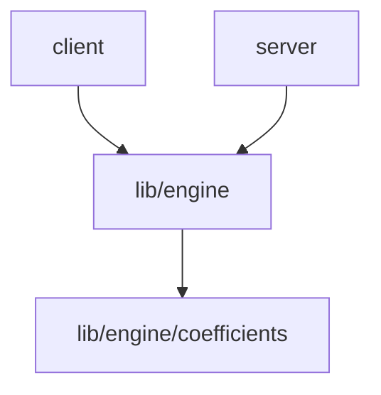

<!-- _templates/ARCHITECTURE.md -->
# ARCHITECTURE

## Module graph

## Dependency rules
| From | May import | Must NOT import |

## Forbidden-import enforcement
ESLint rule location + the exact pattern list.

## The one pipeline
input -> validate -> calculate -> checks -> trace -> narrative -> render -> export
Show the single file that owns each arrow.

## Retired paths
| Path | Replaced by | Archived at | Manifest row |
